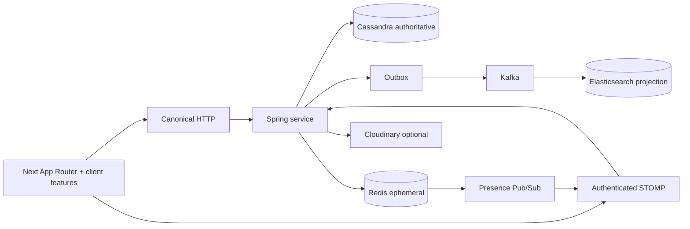

# Architecture

The backend is a Spring Boot service with Cassandra as the authoritative query-
designed store. Redis owns ephemeral typing/presence and distributed send-rate
state. Presence is an aggregate of per-STOMP-session heartbeats: an expiring
sorted set determines whether any device is active, while a user snapshot is
sent through Redis Pub/Sub so every Spring node can fan out to its local
WebSocket sessions. Kafka receives durable outbox events for downstream projections.
Elasticsearch is a rebuildable authorized search projection; Cloudinary is an
optional binary provider. STOMP over SockJS exposes authenticated realtime
commands and user/conversation destinations.

The frontend is React 19 + TypeScript with Zustand feature stores. Next.js 16
App Router is the only build/runtime entrypoint. Every supported URL now has a
native App Router entry; those entries delegate interactive feature trees to a
shared client shell. Browser-only APIs are behind explicit client boundaries;
there are no BrowserRouter hooks or secondary routing runtimes in source.

Global operators use the same frontend/backend deployment through a protected
`/admin` route and `/api/admin/**` controllers. App-level permissions are
server-authoritative; room-local conversation roles cannot grant global access.
The admin room list reads a monthly Cassandra projection rather than scanning
`conversations_by_id`.

WebRTC media is a native 1–1 browser peer connection owned by the frontend;
`CallController` binds the authenticated actor to durable lifecycle commands and
originating-session results; only accepted, authorized peers can relay bounded
ephemeral SDP/ICE. `NEXT_PUBLIC_WEBRTC_ICE_SERVERS` is the only ICE
configuration boundary and has no provider fallback. Production NAT traversal
requires a reviewed STUN/TURN deployment; group/SFU calls are intentionally not
enabled by this contract.

C1 adds an internal `canonical/call` durable authority prerequisite: slot and
typed call snapshot share one conditional Cassandra partition; prewritten expiry
candidates carry expected-slot fences. The controller/client now use it for
active-DM control. C2 has a cyclic fenced recovery worker and exact publication
receipts (ADR0018); C3 still owns history/participants reads and UI. ACCEPTED
means consent/signaling, never proven media connectivity. Live datastore,
crash/restart and broker/media acceptance remain separate gates.

C2's `CallSignalingService` defines correlated sanitized command
results, monotonic per-call views, authority-first fan-out and accepted-peer-only
bounded ephemeral SDP/ICE. A feature-owned client channel provides bounded/timed
correlation; the media hook handles same-call retry, local attempt isolation,
versions, heartbeat/reconnect and negotiation failure. The media session is
memory-only and scoped to the active DM. A separate protected-route inbox
receives canonical participant-private STATE and offers explicit DM navigation,
without automatic devices or answering. Its controlled evidence is in
`tasks/incoming-call-ui-verification-2026-10-22.md`.

`IncomingCallService` adds bounded callee-scoped HTTP discovery through
`incoming_calls_by_user`, prewritten before the authority claim. Fixed 45-second
ringing deadlines and a longer physical TTL avoid projection-delete fencing;
current slot/snapshot, DM membership and blocks decide visibility, not index
payload. Full tuple pagination includes filtered-empty continuation and errors
never masquerade as absence. ADR0019 records the finite-eligibility proof and
load/clock limits. The protected frontend now subscribes before entry/reconnect
lookup, follows filtered-empty pages in bounded batches, and merges HTTP/STATE
through one session/version/hide-aware inbox. Checking/error/continue controls
share the nonmodal notice; late responses are fenced and retries restart from
the head. See `tasks/incoming-call-client-verification-2026-10-22.md` for
controlled evidence and finite-memory/disconnection limits. C3 history and live
datastore/broker/media acceptance remain unfinished.

C3's producer foundation prewrites immutable room/month and both actor/month
history keys before a new-call authority claim (`CallHistoryRepository`,
`CassandraCallHistoryRepository`; ADR0020). Failed/uncertain claims can leave
false-positive hints but no committed call can skip its successful prewrites.
There are no copied statuses or media-attendance claims. The unused participant
projection is replaced in the fresh schema; exact two roles will derive from
authority. `CallHistoryService` now hydrates those hints with current actor
membership, exact DM/participant/start/month scope and bounded authority expiry.
`CallHistoryController` exposes own/room/month pages and exact room/call history,
JSON/no-store. `CallHistoryCursor` binds complete tie keys and scope;
`CallHistoryView` emits only actor-relative outcomes and two role/consent facts,
never raw heartbeat/media data. Archive/block and departed peer do not erase
authorized history; losing actor membership still denies it. See
`tasks/call-history-api-verification-2026-10-23.md`. Member UI and live acceptance
remain open, not implied by these internal/read API implementations.
