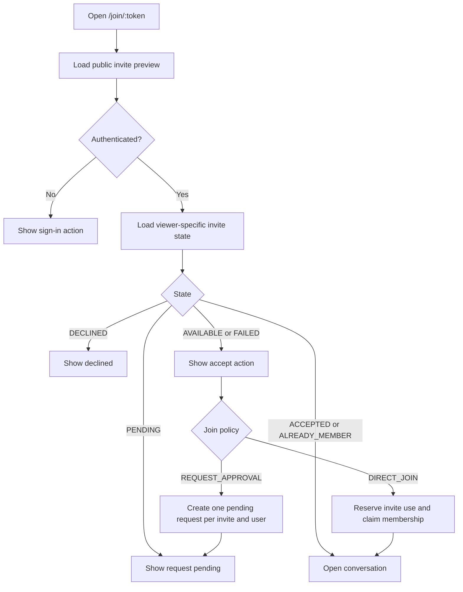
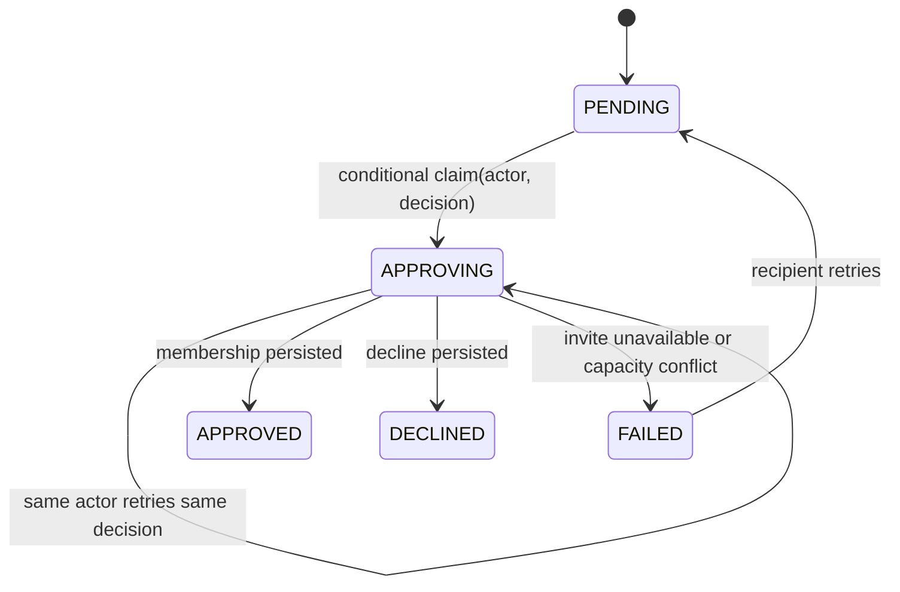

# Invite and join-approval flow

Stable flow ID: `FLOW-INVITE-001`
Feature: `ID-ROOM-003`

## Purpose and boundaries

A room manager creates or revokes a bounded invite. A recipient can inspect the
room without authentication, but viewer-specific state is returned only by the
authenticated `/invites/{token}/status` contract. This keeps a public preview
cacheable and prevents one recipient's decision from leaking to another.

The login action preserves `/join/:token` in the `from` parameter. Failed UI
requests preserve the current page and expose a retry; they never turn an
unknown response into a success state.

## Manager resolution and recovery

`resolution_decision` is immutable once claimed. A manager may resume the same
decision; another authorized manager may take over an expired lease, but cannot
switch APPROVE to DECLINE (or vice versa). Completion uses a conditional write
checking APPROVING and the current owner; rejected completion returns conflict
without writing the community projection. This is not full attempt fencing:
membership and notification side effects still require a shared consistency
boundary, and a reused owner ID is not a unique lease token. Invite-use
reservation is compensated when the membership capacity claim loses a race.
For a direct invite, an existing `ACCEPTED` recipient row means this user
already owns the reserved use: retry skips the use-count mutation and completes
the missing membership even when that reservation consumed the link's final
use. It is not reported to the browser as membership until the member row
exists.
Clean-Cassandra process-kill testing between invite-use reservation and member
creation remains required before claiming crash-atomic approval.

## Permissions, data and verification

- Creating, listing, revoking and resolving require `INVITE_MANAGE`.
- `invite_state_by_token` owns token lookup and use-count CAS.
- Recipient rows in `invite_state_by_token` own recipient idempotency and permit an explicit
  `FAILED` to `PENDING` retry; it never silently treats an unknown status as new.
- `join_requests_by_conversation` is the manager queue. Its resolution claim is
  conditional and records actor plus decision.
- Java regression tests cover merged timeuuid ordering, invalid cursors,
  decision mismatch, same-decision takeover and rejected completion. These use
  controlled repositories/driver responses, not a live Cassandra cluster.
- `test:e2e:room-management` covers progressive disclosure, create, revoke
  confirmation, approval, VI/EN switching, 390px layout and clean browser logs.
- `test:e2e:invites` proves public/authenticated separation, login return URL,
  pending-state restoration after reload, VI/EN copy and 390px layout.

## Cursor ordering

The merged queue uses the full UUID v1 timestamp, then a signed-byte comparison
of clock/node bytes to match Cassandra timeuuid ordering. Millisecond conversion
loses order and can skip requests when the next page uses `requested_at < cursor`.
See Apache Cassandra's
[AbstractTimeUUIDType](https://github.com/apache/cassandra/blob/cassandra-5.0/src/java/org/apache/cassandra/db/marshal/AbstractTimeUUIDType.java).
The existing cursor still contains only requestedAt; exact UUID collisions across
the two sources need a composite cursor or unified queue before claiming a fully
collision-proof pagination contract.
