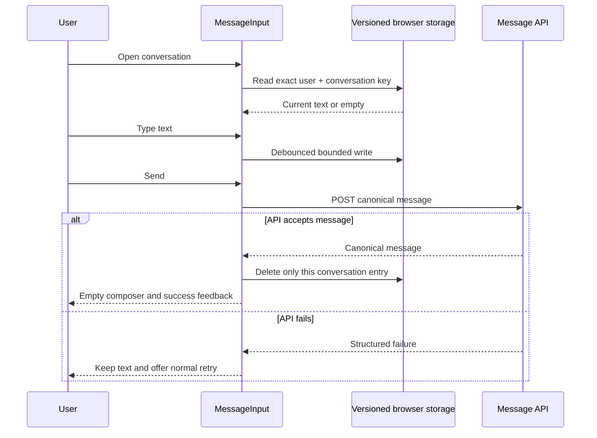

# Message draft ownership and recovery

Stable flow: `FLOW-MESSAGE-001`
Feature: `ID-MESSAGE-001`

## Purpose and boundaries

An authenticated user can leave a room, reload the app or recover from a failed
send without losing unsent text. Drafts are local to the current browser profile;
they are not durable server messages and never grant access to a conversation.

The storage authority is the exact tuple `(userId, conversationId)`. The current
schema stores text only, up to the canonical 20,000-character message limit, at
most 50 recent rooms and for no more than 30 days. Files are deliberately not
persisted because browsers cannot safely restore `File` objects after reload.
Editing uses separate state, so message content being edited never overwrites or
enters the unsent draft.

## State and user flow

```mermaid
stateDiagram-v2
    [*] --> Empty
    Empty --> Drafting: User types
    Drafting --> Persisted: 300 ms bounded write or room unmount
    Persisted --> Drafting: Reopen room or reload
    Drafting --> Editing: Edit an existing message
    Editing --> Drafting: Cancel or save edit
    Drafting --> Sending: Submit message
    Sending --> Drafting: HTTP failure; preserve text
    Sending --> Empty: HTTP success; delete this room draft
    Persisted --> Empty: Older than 30 days
```

## Validation, privacy and recovery

- Unknown, malformed or non-version-1 storage is removed, not migrated or
  interpreted through a compatibility shape.
- A second authenticated account uses a different key and cannot render the
  first account's draft through product UI.
- Successful message edits preserve the unrelated unsent draft. Editing does
  not emit typing state or persist edited content as a draft.
- Storage denial or quota failure leaves the in-memory composer usable and is
  recorded as a diagnostic warning without adding persistent UI clutter.
- Reload is the authoritative recovery check. WebSocket delivery is not used as
  proof that a draft or sent message is durable.

## Verification and observability

- `npm run test:e2e:message-drafts`: room isolation, full reload, expected send
  failure, successful-send cleanup, account isolation, invalid-schema deletion,
  canonical max length, mobile overflow, console and request-failure audit.
- `npm run test:e2e:message-edit`: cancel/save edit restores the unrelated draft.
- Diagnostic events omit draft content and log only storage operation failures.

Remaining distributed proof belongs to canonical message persistence and
realtime delivery, not to this device-local draft flow.

## Unconfirmed attachment commands (2026-10-23)

Source dimensions/duration now survive canonical upload/send mapping. A failed
local optimistic message retains an in-memory `pendingSend` command snapshot;
bubble retry sends that exact original command/ID in its original room, including
mention/reply/sticker/GIF/attachment fields. It does not reconstruct a command from
display text or create a new ID fallback. Confirmation clears the snapshot.

The snapshot is not persisted with drafts or stored as plaintext in the per-tab
fingerprint store. Attachment reload recovery, reuse of uploaded batches on a
composer retry and draft-aware selected-file cleanup after bubble retry remain
separate work. Evidence: `tasks/attachment-metadata-verification-2026-10-23.md`.

## Composer upload recovery follow-up (2026-10-23)

Confirmed per-file upload metadata is now reused within the mounted actor/room
composer. A failure in a later upload does not discard earlier confirmed progress
or send a partial attachment list. Message-send retry keeps the same assets and
original canonical command identity when the draft has not changed.

The local preparation callback is not sent to the backend or fingerprint store.
Canonical confirmation removes only File objects belonging to that send. Text and
reply are cleared only for the unchanged revision/context; new text/files remain.
Scope disposal aborts client HTTP and prevents late old-room sending/cleanup.

This does not persist selected File objects across unmount/reload, reconcile an
unconfirmed provider outcome or establish provider rollback. Evidence and remaining
M2/M3 gates: `tasks/composer-upload-recovery-verification-2026-10-23.md`.
